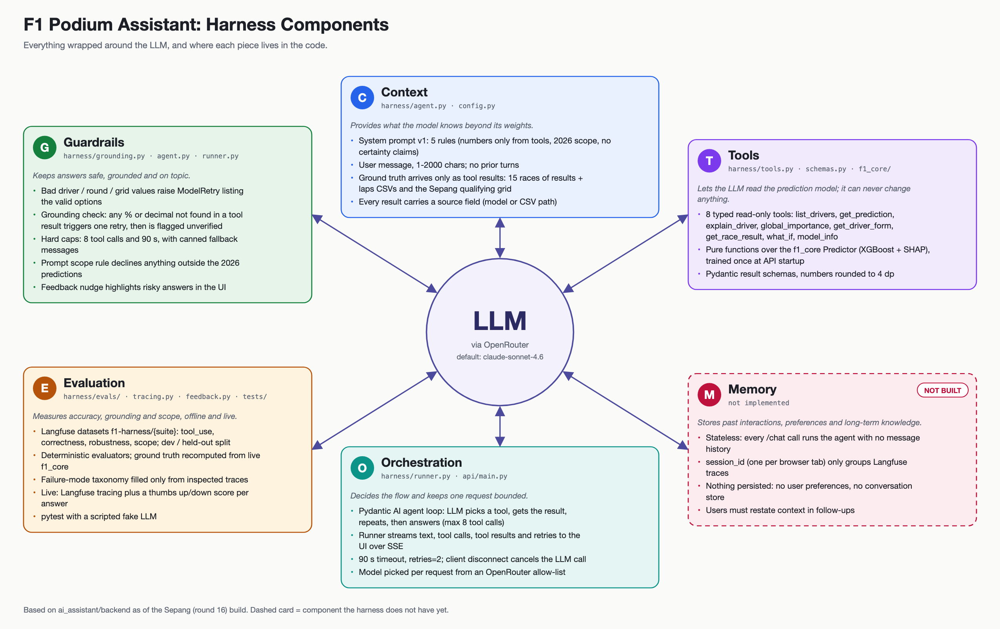

[☕ Buy me a coffee](https://www.buymeacoffee.com/cole.codes) if you find this F1 project helpful :)

# f1-projects

Projects built around the [FastF1](https://github.com/theOehrly/Fast-F1) API
for the 2026 F1 season. The main work is a per-race podium predictor and a
read-only Q&A assistant over one of its predictions; a handful of smaller
side projects (driver style analysis, telemetry visualization, highlight
reels, a VS Code extension) sit alongside.

## Repo layout

```
predictions/      one directory per Grand Prix + shared race data (data_pred/data/)
ai_assistant/     Q&A assistant over a podium prediction
  backend/          api/ (FastAPI), harness/ (agent), f1_core/ (model), tests/
  frontend/         React + Vite chat UI
  docs/             architecture diagrams (and local-only specs)
miscellaneous/    standalone side projects
```

Shared tooling lives at the root: `pyproject.toml`, `uv.lock`, `.env` (local,
gitignored; copy `.env.example`), `.venv/`. Run all commands from the repo
root. Setup: `uv sync` (Python >= 3.13, managed by [uv](https://docs.astral.sh/uv/)).

## Podium prediction (`predictions/`)

Each GP directory (`austria/`, `belgium/`, `monaco/`, `sepang/`, `singapore/`,
...) is a self-contained snapshot of the same pipeline, one per Grand Prix,
predicting the top-3 finishers using an XGBoost binary classifier trained on
all completed races in the 2026 season up to that point. All GPs read the
shared CSVs in `predictions/data_pred/data/`.

```bash
uv run python predictions/{gp}/fetch_data.py   # fetch race data from FastF1 -> predictions/data_pred/data/
uv run python predictions/{gp}/model.py        # train model + print podium prediction
```

Each GP directory is a point-in-time snapshot (its own `fetch_data.py`,
`model.py`, FastF1 `cache/` and `podium.html`), not a shared library;
copy-and-adapt the latest one for a new race. Workflow for predicting a new
race, feature engineering (22 features: grid position, lap aggregates, sprint
results, etc.), XGBoost config, CSV schema and the current season state are in
[predictions/CLAUDE.md](predictions/CLAUDE.md).

## AI assistant (`ai_assistant/`)

A read-only Q&A agent over the Sepang (round 16) prediction. It answers
questions such as "Why does the model like Hamilton?" or "What if Russell
qualified on pole?" by calling typed tools over the same XGBoost + SHAP
pipeline, and checks that every number in its answer came from a tool result.

- **Backend:** FastAPI streaming SSE, a [Pydantic AI](https://ai.pydantic.dev/)
  agent with 8 tools, guardrails (input validation, numeric grounding check,
  tool-call and time caps), Langfuse tracing and an eval suite. LLMs are called
  through OpenRouter.
- **Frontend:** React chat UI that shows each tool call live and collects
  thumbs up/down feedback.

```bash
uv run uvicorn ai_assistant.backend.api.main:app --port 8000   # API
cd ai_assistant/frontend && npm install && npm run dev         # UI on :5173
uv run python -m ai_assistant.backend.harness.chat "question"  # one-shot CLI check
uv run pytest                                                  # all tests
```

Needs `OPENROUTER_API_KEY` in `.env` (Langfuse keys are optional), and
`brew install libomp` on macOS for XGBoost. See
[ai_assistant/CLAUDE.md](ai_assistant/CLAUDE.md) for details and evals.

Diagrams: [full architecture](ai_assistant/docs/architecture.png) and
[harness components](ai_assistant/docs/harness-components.png).



## Side projects (`miscellaneous/`)

| Directory | What it is |
|---|---|
| `driver_similarity/` | PCA + clustering over six driving-style features (qualifying pace, overtakes, tire preservation, braking, aggression, wet performance) to group 2026-grid drivers by how they race, rendered as an HTML map. Has its own tests in `driver_similarity/tests/`. |
| `gforce_mapping/` | Reconstructs lateral G-force around a lap (Norris, 2025 British GP) from FastF1 telemetry and renders an animated track map / highlight reel. See `gforce_mapping/HANDOVER.md` for the G-force calculation approach. |
| `leclerc_british_gp_highlights/` | Telemetry-driven highlight video generation for a specific race battle (2025 British GP). |
| `lewis_barcelona_p1/` | Standalone HTML/video build for a single lap/session visualization. |
| `custom_flag_alarm/` | A local VS Code extension: a green/yellow/red flag in the sidebar that tracks how long you've been coding and nudges you to take a break. Not F1 data related; see `custom_flag_alarm/README.md`. |
| `race_dashboard/` | Replay dashboard for the 2026 Singapore GP built from FastF1 position telemetry: team-coloured labelled dots on the track map, a live leaderboard with gaps, lap/lap-time status and play/seek/speed controls. FastAPI backend + React/Vite frontend; see `race_dashboard/CLAUDE.md` for how to run it (`uv run uvicorn ...` and `npm run dev`). |

## Notes

- `cache/` directories (FastF1's local API cache), `.venv/`, `node_modules/`
  and `.env` are gitignored. Regenerate caches by running a project's
  `fetch_data.py`.
- `ai_assistant/docs/superpowers/` holds local-only design specs and plans
  (gitignored).
